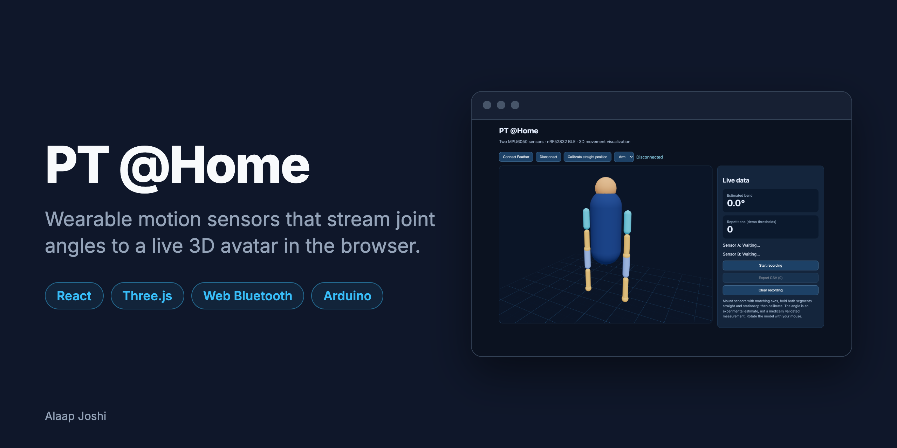
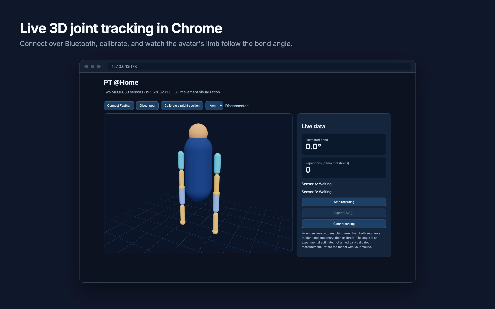
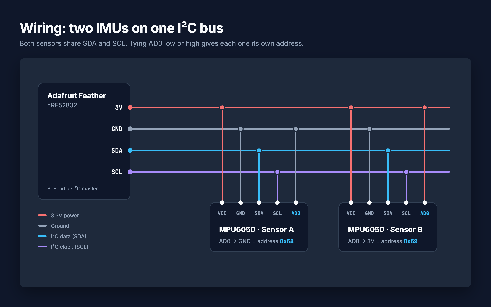
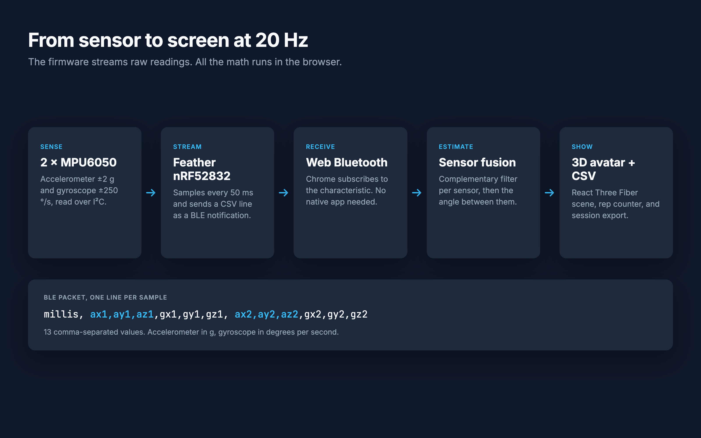
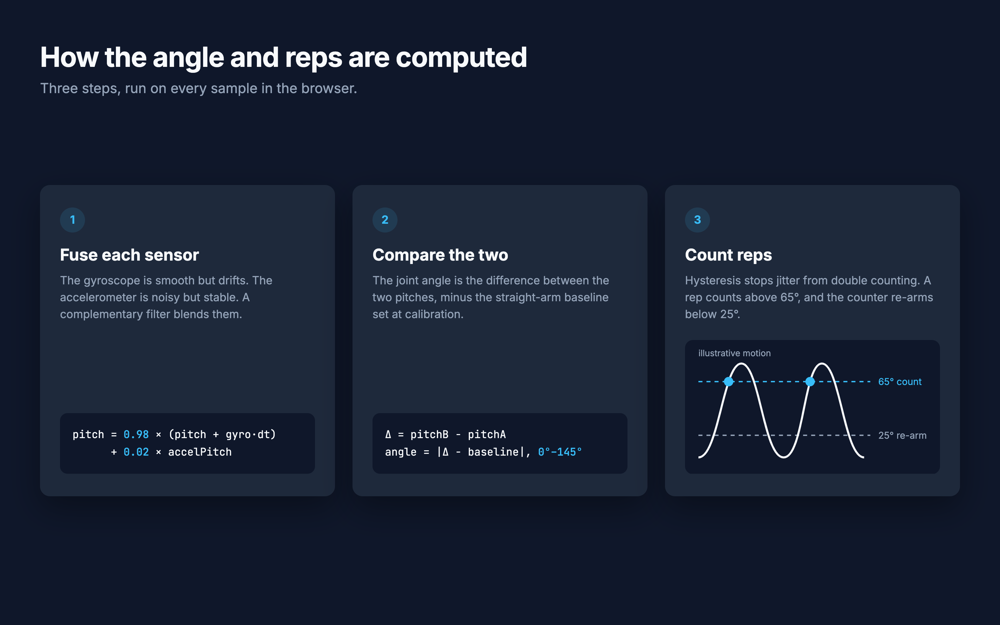

# PT @Home

> Wearable motion sensors that stream joint angles to a live 3D avatar in the browser, built for people doing physical therapy at home.

   

## About

Physical therapy depends on doing exercises correctly at home, but patients get almost no feedback once they leave the clinic. PT @Home puts two IMU sensors on either side of a joint, streams their motion over Bluetooth Low Energy, and shows the bend angle live on a 3D body while counting reps. It needs no app install: the browser talks to the hardware directly through Web Bluetooth, and all sensor fusion runs client-side.

> This is a prototype, not a medical device. The angle and rep count are experimental estimates and must not be used for medical decisions.

## Features

- Streams two MPU6050 sensors at 20 Hz over BLE straight into Chrome with Web Bluetooth.
- Estimates the joint angle by fusing gyroscope and accelerometer data with a complementary filter.
- Renders a live 3D avatar in React Three Fiber, switchable between arm and leg mode.
- Counts reps with hysteresis so sensor jitter does not double count.
- Calibrates the straight position in one click.
- Records sessions and exports raw sensor data plus the estimated angle as CSV.

## Gallery

<table>
  <tr>
    <td width="50%"> The web app: 3D avatar, controls, and live data panel</td>
    <td width="50%"> Wiring: two IMUs on one I²C bus, split by the AD0 pin</td>
  </tr>
  <tr>
    <td width="50%"> Data pipeline and the BLE packet format</td>
    <td width="50%"> How the angle and reps are computed</td>
  </tr>
</table>

## Tech Stack

| Layer | Technology |
|---|---|
| Frontend | React 19, React Three Fiber, drei, Three.js |
| Hardware | Adafruit Feather nRF52832, 2 × MPU6050 IMU |
| Firmware | Arduino C++, Adafruit Bluefruit nRF52 library |
| Connectivity | Bluetooth Low Energy, Web Bluetooth API |
| Tools | Vite 6, Arduino IDE |

## Getting Started

### Prerequisites

- [Node.js](https://nodejs.org) 20+
- [Arduino IDE](https://www.arduino.cc/en/software) with the Adafruit nRF52 board package ([setup guide](https://learn.adafruit.com/bluefruit-nrf52-feather-learning-guide/arduino-bsp-setup))
- Chrome or Edge. Safari and Firefox do not support Web Bluetooth.
- Hardware: an [Adafruit Feather nRF52832](https://www.adafruit.com/product/3406), two 3.3V-compatible MPU6050 breakouts, a breadboard, jumper wires, and optionally a LiPo battery.

Wire both sensors to the same I²C bus. The AD0 pin gives each one its own address:

| MPU6050 pin | Sensor A | Sensor B |
|---|---|---|
| VCC | 3V | 3V |
| GND | GND | GND |
| SDA | SDA | SDA |
| SCL | SCL | SCL |
| AD0 | GND (address `0x68`) | 3V (address `0x69`) |

Keep everything at 3.3V. Never put 5V on the Feather's pins.

### Installation

~~~bash
git clone https://github.com/alaapjoshi/PT-Home.git
cd PT-Home/web
npm install
~~~

Flash the firmware:

1. Open `firmware/firmware.ino` in the Arduino IDE.
2. Select **Tools > Board > Adafruit Feather nRF52832** and the matching port, then upload.
3. Open the Serial Monitor at 115200 baud. You should see `MPU 0x68: OK, MPU 0x69: OK` followed by streaming CSV lines. If a sensor shows `MISSING`, check its AD0, power, and SDA/SCL wires.

### Usage

From the `web/` folder:

~~~bash
npm run dev
~~~

Open http://127.0.0.1:5173 in Chrome or Edge, then:

1. Click **Connect Feather** and pick `Feather-Rehab` in the Bluetooth dialog.
2. Mount the sensors on two adjacent body segments, such as the upper arm and forearm, with matching axis orientation.
3. Hold the limb straight and still, then click **Calibrate straight position**.
4. Choose **Arm** or **Leg** and move slowly. The avatar's limb follows, and the panel shows the bend angle and rep count.
5. Click **Start recording**, then **Export CSV** to download `rehab-session.csv`.

## Project Structure

~~~text
PT-Home/
  firmware/
    firmware.ino               # Arduino sketch: reads both IMUs, streams CSV over BLE
  web/
    src/
      App.jsx                  # BLE connection, rep counter, recording, UI
      components/Avatar.jsx    # 3D body and scene (React Three Fiber)
      lib/sensorFusion.js      # BLE UUIDs and the complementary filter
      main.jsx                 # React entry point
  docs/images/                 # README images and their HTML sources
~~~

## How It Works

~~~mermaid
flowchart LR
    A[MPU6050 A 0x68] -- I²C --> C[Feather nRF52832]
    B[MPU6050 B 0x69] -- I²C --> C
    C -- BLE notify CSV at 20 Hz --> D[Chrome Web Bluetooth]
    D --> E[Complementary filter per sensor]
    E --> F[Relative angle and rep counter]
    F --> G[3D avatar and CSV export]
~~~

Every 50 ms the firmware reads both sensors and sends one CSV line on a custom BLE characteristic:

~~~text
millis,ax1,ay1,az1,gx1,gy1,gz1,ax2,ay2,az2,gx2,gy2,gz2
~~~

Accelerometer values are in g and gyroscope values in degrees per second. The firmware sends raw data only; all the math runs in the browser:

1. **Fuse each sensor.** A 98/2 complementary filter blends the integrated gyroscope rate, which is smooth but drifts, with the accelerometer's pitch, which is noisy but stable.
2. **Compare the two.** The joint angle is the difference between the two sensors' pitches, minus the baseline captured at calibration, clamped to 0–145°.
3. **Count reps.** A rep counts when the angle passes 65°. The counter re-arms only after the angle drops below 25°, so small wobbles near one threshold are ignored.

## Future Improvements

- Track full 3-axis orientation with quaternions (Madgwick or Mahony filter) instead of a single-axis estimate that assumes aligned sensors.
- Add per-user anatomical calibration and validate the angles against a goniometer.
- Save sessions and patient history to the cloud instead of keeping them in browser memory (currently capped at about 10 minutes).
- Add exercise programs with target ranges and live feedback.

## Author

**Alaap Joshi** - Computer Science + Cognitive Science, Rutgers University-New Brunswick
[GitHub](https://github.com/alaapjoshi) | [LinkedIn](https://linkedin.com/in/alaapjoshi)

## License

MIT. See [LICENSE](LICENSE).
